# Router–Worker Architecture

A Windows migration package for a Codex Router–Worker setup. It coordinates a primary session and named subscription workers, with a local controller in observe mode. This is a user-maintained project, not an official OpenAI product.

## Architecture and task flow

```mermaid
flowchart TD
    User([User request]) --> Root["Primary session · Terra / high<br/>Scope, coordination, UI and acceptance"]
    Root --> Scope["Classify work and prepare<br/>bounded task context"]
    Scope -->|"Built-in spawn_agent<br/>named role · independent context"| Route{"Select a worker<br/>when appropriate"}

    Route -->|Implementation| Sol["Sol execution<br/>Implement and test"]
    Route -->|Independent review| QA["Sol QA<br/>Review in a separate session"]
    Route -->|Bounded batch| Luna["Luna<br/>Fixed-process work"]
    Route -->|Difficult analysis| Astra["Astra<br/>Advisory review and planning"]

    Sol --> Results["Worker results and evidence"]
    QA --> Results
    Luna --> Results
    Astra --> Results
    Results --> Verify["Primary session verifies results,<br/>integrates and decides acceptance"]
    Verify --> Output(["Deliver result to user"])

    Hooks["Routing Hooks<br/>Observe supported tool events"] -.->|"Observed events"| Controller["Local Controller<br/>Observe mode · dispatch disabled"]
    Scope -.->|"Supported events"| Hooks
    Controller -.->|"Status and inbox"| Root

    classDef primary fill:#e5efff,stroke:#386ac3,color:#152e58,stroke-width:2px;
    classDef worker fill:#e7f7f3,stroke:#248573,color:#123e36;
    classDef observe fill:#fff5df,stroke:#b9801e,color:#593a08,stroke-dasharray: 5 5;
    classDef output fill:#f0eafe,stroke:#8063b8,color:#35264d;
    class Root,Scope,Verify primary;
    class Sol,QA,Luna,Astra worker;
    class Hooks,Controller observe;
    class User,Output output;
```



The primary session owns the final decision. A worker is selected only when the task and host support that route; Sol QA is separate from the implementation author. Astra is advisory. Hook observations and Controller status are evidence of observed events, not proof of acceptance. The retired Worker API route is not used for new tasks.

## Download

[Download the v3.0.10 Windows migration package](router-worker-windows-v3.0.10.zip).

SHA-256: `bd5c2695bec10ce46a4fe7952abd48dba96cecbbe2d0069c10052e8383eaf0cc`

## What is included

- The Windows installer, routing guidance, named worker roles and local controller.
- Direct subscription dispatch for new tasks; the older paid Worker API dispatch route is retired.
- Legacy compatibility code for previously frozen tasks. The archive itself contains no task databases or historical task ledger.

## Installation

The package requires Windows, Codex and Python 3.12 or newer. Extract the archive and, from `Router-Worker-Windows`, run:

```powershell
python -X utf8 -B .\portable.py check-package
python -X utf8 -B .\portable.py install
python -X utf8 -B .\portable.py install --apply
python -X utf8 -B .\portable.py verify
```

The first install command previews changes. A fresh install starts in maintenance mode; follow the packaged README to review settings, exit maintenance, restart Codex and verify role dispatch and Hook callbacks on the destination. Review Hook trust in Codex. Do not treat configuration or offline tests as proof of live behavior.

The fresh installer refuses an existing integration directory. Existing installations require the upgrade instructions in the package; their prior task state may be preserved. Read the rollback instructions before making changes.

## Verification and version scope

The archive passed its package integrity check and an isolated fresh installation; initialized Worker and Controller task databases were empty. Destination live execution and Hook callbacks need separate verification. The archive is the v3.0.10 release; later changes to the maintainer's local installation are not included.

No license is specified. Contact the repository owner before reuse or redistribution.
